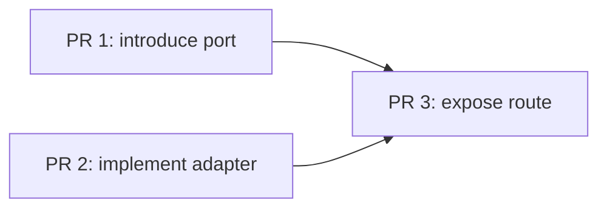

# PROJ-XXX — <short title>

**Ticket:** <tracker URL for PROJ-XXX, from the `## Issue tracking` Ticket URL template when set>

## Summary

Restate the ticket's story in one line, so the file stands alone once the ticket is closed. Pull the user-intent line straight from the ticket. This is not the place to redesign the story.

## Relevant files

Files executor must read before write code. Filled during spec exploration — list code with reusable logic, similar patterns, shared types, layer boundaries, or directly-modified surfaces.

Name **check** guarding each file — test or command that go red if change wrong. File with no named check = nothing catch it.

- `src/path/to/file.ts` — why matter — guarded by `test/path/to/file.spec.ts`
- `src/path/to/another.ts` — why matter — guarded by `pnpm test <pattern>`

## Red flags

Code smells in target area to fix before or during work — not extend around. Examples: oversized files, tangled responsibilities, duplicated logic, missing layer abstraction, tests hard to extend.

Red flag bad enough to need cleanup first → note as sub-step executor do before main ACs.

- (none, or list smells found during exploration)

### Contradictions

Where repo reality disagree with itself — code vs tests vs docs vs config vs history. Output of `/spec` step-3 `repo-forensics` pass. Don't silently pick winner: docs may be stale *and* implementation may be wrong.

| Surface | Claim or behaviour | Evidence locator | Conflicts with | Risk | Disposition |
|---|---|---|---|---|---|
| docs / tests / code / config / history | what it says or does | `file:line`, test, config key, commit | what it conflicts with | delivery risk | clean now / mark / mitigate / ticket / add test / update guidance / defer / human decision |

Inspected surfaces agree → write "No contradictions detected between the inspected surfaces." Don't invent row to fill table.

### Stale or possibly stale

Docs, comments, tests, or assumptions maybe outdated — each with **what make it look stale** (contradicted by code, by tests, by runtime, by recent commits, or no longer match requirements). Age alone not evidence: old can be right, new can be wrong.

- (none, or e.g. `docs/x.md` — contradicted by `src/y.ts:42` — mark + follow-up ticket)

## Architecture sketch

*Include section only when ≥3 components join change, or event order matter across new flow. Omit section header entirely if rule not trigger — empty section worse than no section.*

One short Mermaid sequence or flowchart diagram (~10 nodes max) plus one paragraph naming seam(s) introduced and why they live where they do.

## Domain model

This section records the delta. Update the canonical domain model named by the repository instructions at ticket close, when one exists.

### Added: <EntityName>

- (use the repository's domain-model shape; otherwise Purpose / Identity / Invariants / Lifecycle / Relationships / Canonical type)

### Changed: <EntityName> (<what changed>)

- (only the lines that changed; everything else still lives in the canonical doc)

### Renamed: <OldName> → <NewName>

- (note any call-site changes the rename forces beyond the type itself)

### Referenced (unchanged): <Entity1>, <Entity2>

- (only list if the spec's logic depends on these; omit otherwise)

No entities touched → write "N/A — no domain entities added, changed, or renamed" plus one-line reason. Don't omit section header — explicit "N/A" is signal domain modelling was considered.

## Acceptance criteria

Restate the ticket's ACs as concrete **input → output** statements, ready to translate direct into tests. Add specificity the ticket not carry (exact field names, error types, edge cases).

**Ticket has cross-repo footprint (see `/spec` step 3c) → tag each AC with implementation location and verification mode.** Let slice-executor see at glance which ACs to TDD and which to skip with scratch note. Use one of:

- `in-repo / unit test` — slice-executor implement via TDD; verified by automated test in this repo
- `in-repo / integration test` — implementable in this repo with Testcontainers or similar; verified by integration test
- `cross-repo / manual verification` — outside this repo's executor scope (infra, ops, deployment readiness); verified manually against deployed environment

Drop tags if every AC is `in-repo / automated` — noise for single-repo tickets.

- [ ] **AC[1] — `in-repo / unit test`:** Given <input>, when <action>, then <exact expected output>.
- [ ] **AC[2] — `in-repo / unit test`:** Given <empty/zero case>, when <action>, then <specific handling>.
- [ ] **AC[3] — `in-repo / integration test`:** Given <boundary input>, when <action>, then <specific outcome>.
- [ ] **AC[N] — `cross-repo / manual verification`:** *(only if applicable)* Given the deployed environment, when <action>, then <observable outcome verified manually>.

## Interface

What change on public surface. Sketch types — param names, return shapes, error codes.

For every new field or param, answer:
- **What does it contain?** ("string" not enough — what information?)
- **What are the realistic bounds?** Length, range, collection size.
- **What's the zero / empty case?** Is "absent" vs "empty" meaningful?
- **What's the adversarial case?** Large input, special characters, concurrent calls.

```typescript
// Type sketches go here
```

Change internal-only (no public surface change) → write "N/A — internal change" plus one line why.

## Security

Output of `/spec` step-3e threat pass. Trust boundaries, authn/authz model, and STRIDE threats material to *this* change — each with disposition. Threats needing design call live in `## Open decisions`; testable mitigations become entries in `## Acceptance criteria`; this section = map tying them together.

- **Trust boundaries & entry points:** who call new/changed surface, and how each caller authenticated (user token vs service / M2M).
- **Authorization:** what permit each operation (per-endpoint scope/permission); for multi-tenant data, what enforce tenant isolation.
- **Sensitive data:** PII / secrets touched (Law 8) — what persisted, logged, or emitted.

| STRIDE threat | Surface | Mitigation | Disposition |
|---|---|---|---|
| <e.g. Elevation: any valid caller writes another tenant's data> | <endpoint> | <e.g. service-scoped permission via PermissionsGuard> | AC[N] / open decision / control exists / accepted |

Change introduce no new trust boundary and touch no sensitive data → write "N/A — no new trust boundary or sensitive data; STRIDE walk found nothing material" plus one-line reason. Don't drop header — explicit N/A is signal pass ran.

## Open decisions

Architectural forks where multiple approaches have meaningfully different correctness, risk, or maintainability profile. Spec **cannot be dispatched for implementation** until every entry here resolved.

For each unresolved decision:
- **Decision:** the question, framed as a choice
- **Options:** the viable approaches (2-3 max)
- **Tradeoffs:** correctness, maintainability, risk — not just effort
- **Recommendation:** a pick with reasoning, or "needs user input" if genuinely balanced

Once resolved, replace the question with the chosen approach, its reasoning, and its consequences: what it enables, what it rules out, and what to watch for. That record stays in the spec.

Never write "the executor should choose" — that defer design decision to agent not equipped to make it.

- (none, or list forks found during exploration)

## Rollout

Ordered merge sequence. One entry per independently safe slice: one branch, one PR, one merge to `main`. A one-slice sequence is the common case.

A boundary is valid when:

1. The repository verification command is green.
2. Deploying the slice is safe.
3. One sentence states what becomes true on `main`.

Declare how each slice stays safe before the ticket is complete:

- `complete` — reachable and complete for its input domain
- `unwired` — implemented and tested, but nothing calls it
- `flagged` — wired behind a named flag; include its default and removal condition

Once a surface is reachable, its safety envelope ships in the same slice. Authorization and input validation for a registered route cannot be deferred.

For three or more slices, or when dependencies are not obvious, add a small Mermaid graph. Nodes name the PR outcome; an arrow means “must merge before.” Omit edges between independently reorderable slices. The ordered entries below remain authoritative, so omit the graph when it would only restate a simple one- or two-PR sequence.




### Slice N — AC list — exposure: complete | unwired | flagged

What becomes true on `main` when this merges.

Boundary: why these ACs belong in one reviewable merge.

- (single slice, or the ordered sequence)

## Edges

Constraints that not acceptance criteria but bound implementation. These become regression tests or guard assertions, not features.

Examples:
- Performance expectations
- Compatibility constraints
- Interactions with existing services / events / messages
- **Blast radius** — callers, consumers, contracts that could break, found during `repo-forensics` pass. Shared helper's other call sites belong here, not just path ticket names.

- (none, or list constraints found during exploration)

## Done-when

Verification checklist. `/spec` emits one slice block for every `## Rollout` entry. `/slice` walks that block before its PR becomes ready and ticks it once the slice's gates pass; per-ticket items run once after the final slice merges. A ticked block attests that those gates passed for the commit that merged. The boxes for an in-flight slice remain empty until that slice ends.

### Slice <n>

- [ ] Every AC assigned to this slice is implemented and verified by at least one test
- [ ] Production code follows the production-code recipe `## Stack recipes` names, apart from the deviations the repository documents (validated by its production-code validator)
- [ ] Test code follows the test-code recipe `## Stack recipes` names, apart from the deviations the repository documents (validated by its test-code validator)
- [ ] Architecture layer boundaries are respected (validated by the architecture reviewer `## Review routing` names)
- [ ] Security review completed for every security-relevant batch
- [ ] Repository verification command passes
- [ ] **Stacks with a boot-smoke rule in `## Stack recipes` only:** boot-smoke e2e exists and passes — the whole application module compiles and initialises against self-contained infrastructure
- [ ] Slice fits in one PR a reviewer can assess thoroughly in one sitting
- [ ] The slice's declared exposure still holds
- [ ] Public-surface documentation is updated when this slice makes a surface reachable

### Per ticket

- [ ] No unresolved entries remain in Open decisions
- [ ] Every threat in Security has a disposition: control exists, AC, resolved decision, or accepted risk
- [ ] Every contradiction in Red flags has a disposition
- [ ] Every `cross-repo / manual verification` AC has recorded evidence and an owner
- [ ] Non-obvious durable guidance is captured in the canonical document named by the repository instructions
- [ ] Every `flagged` slice's flag is removed or has a live removal ticket
- [ ] Domain model deltas are merged into the repository's canonical domain model when one exists
- [ ] Outcome and open handoff entries are harvested into their canonical destinations

## Outcome

> *Appended at ticket close (`/slice` Route F), not during drafting.*

**Result:** <what shipped>

**Reflection:**
- What went well?
- What did not go well?
- What took longer than it should have?
- What would you recommend to the next agent picking up related work?

**Architectural decisions worth preserving:** <if any>
